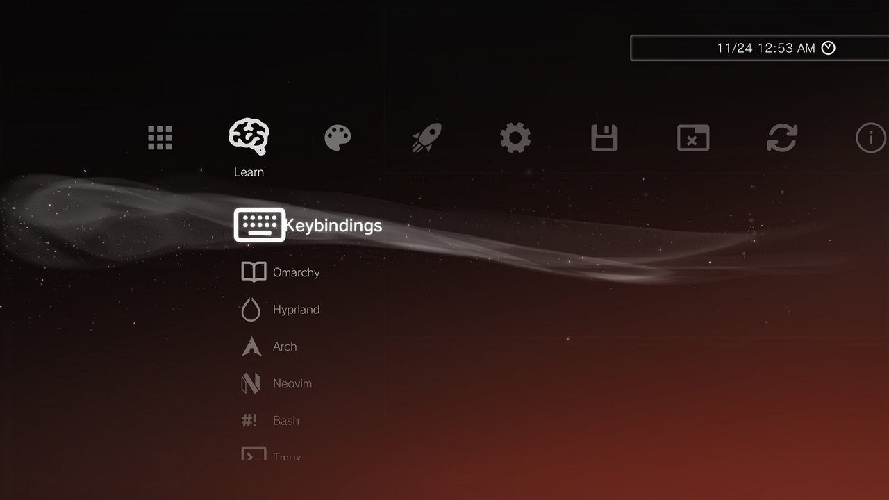

# Crossbar for Omarchy

[](https://github.com/tcballard/omarchy-badges)

A PS3-authentic XrossMediaBar (XMB) interface for Omarchy's main menu (`SUPER + SPACE`), forked from [surfacedP/omarchy-xmb-menu](https://github.com/surfacedP/omarchy-xmb-menu). Preserves the full Omarchy menu tree, application launcher, providers, global search, and bar widget while upgrading the presentation to firmware-faithful 1080p/4K proportions, 2-beat multi-level drilldowns, pulsing `PhText` selection glow, a TV-safe-zone clock bar, and optional live integration with the native Vulkan [modern-moyou](https://github.com/keylimesoda/modern-moyou) ribbon & bokeh particle engine.

https://github.com/user-attachments/assets/f8db8f96-6ca9-4dcd-9c3e-62ebc8088720



## What you get

- **Firmware-faithful XMB geometry:** Exact 1080p-referenced scaling (`panel.height / 1080`) up to 4K, 90% TV overscan safe-zone top-right clock bar with live analog dial, and `OutQuart` D-pad scroll & focus easing.
- **Multi-level drilldowns (L2, L3, L4+):** Authentic 3-column accordion collapse (shifted active category, collapsed parent icon + `◀` back chevron + dimmed icon-only sibling stack) with Sony's 2-beat 100 ms label stagger and zero-handoff return glide.
- **Authentic `PhText` selection glow & idle fade:** Centered sinusoidal white shadow bloom on the active label (`0.35 ↔ 0.95`, 1.8 s cycle) and automatic idle fade-out of unselected vertical labels while resting.
- **Dual background renderers:**
  - **Optimal path:** Auto-discovers `modern-moyou` (Vulkan 1.4 + AVX-512 Wayland `wlr-layer-shell` underlay) with live navigation particle wind and real-time hover-preview IPC over `$XDG_RUNTIME_DIR/modern-moyou-wind.sock`.
  - **Zero-dependency fallback:** Built-in pure-QML shader ribbon and frosted-glass clock capsule activate automatically if `modern-moyou` or optional assets are not installed.
- **In-menu customization (`Appearance → XMB Menu`):** Live-preview Theme / Wave `.qrc`, Month / Color sync, Time of Day sync, Background Opacity, Font, Clock Format (12h/24h), and Renderer, persisted to `~/.config/omarchy/crossbar.json`.

## Controls

- `Left` / `Right`: switch root categories (or step back/forward in submenus)
- `Up` / `Down` / `PageUp` / `PageDown`: scroll vertical items
- `Enter` / `Right`: open submenu, launch app, or confirm setting
- `Left` / `Backspace`: go back (and revert uncommitted setting hover-previews)
- `Esc` or `SUPER + SPACE`: dismiss cleanly
- Type anywhere: global search across menu entries and applications
- `Delete`: uninstall a selected application (with confirmation modal)
- Mouse wheel, touchpad scroll, and direct click supported throughout

## Optional: Native Vulkan `modern-moyou` Backend

Crossbar works out of the box with its built-in QML shader ribbon, and ships 4 `modern-moyou-theme/v1` JSON presets (`themes/lines.json` as the default, plus `classic-silk.json`, `midnight-obsidian.json`, and `deep-cobalt.json`) so the native Vulkan backend works immediately on a fresh install:

1. Install [modern-moyou](https://github.com/keylimesoda/modern-moyou) on your `$PATH` (or build into `~/modern-moyou/build/modern-moyou`, or set `MODERN_MOYOU_BIN`).
2. Reopen the menu—Crossbar detects `modern-moyou` automatically, launches with the bundled `themes/lines.json` default (or `builtin` procedural fallback), and exposes all bundled `.json` presets plus any custom `.json` or user-supplied `.qrc` themes placed in `~/.local/share/modern-moyou/` or `/usr/share/modern-moyou/themes/` under **Appearance → XMB Menu → Theme / Wave**.

## Requirements

- Omarchy 4 / Quattro with the Quickshell plugin system
- Python 3 stdlib (used for startup binary/asset discovery, UNIX datagram wind bridge, and atomic settings writes)
- Optional: `modern-moyou` binary for the native Vulkan underlay

## Files written & processes launched

- **Settings file written:** `~/.config/omarchy/crossbar.json` (only when you change a setting under `Appearance → XMB Menu`; left intact on plugin removal so reinstalls preserve preferences).
- **Processes launched:**
  - Startup one-shot Python probe to locate `modern-moyou` and available `.qrc` themes.
  - While the menu is open with the native backend active: `modern-moyou --layer-shell ...` and a lightweight Python `AF_UNIX` `SOCK_DGRAM` bridge writing navigation/preview commands to `$XDG_RUNTIME_DIR/modern-moyou-wind.sock` (both terminate cleanly on menu close).
  - Standard Omarchy menu guards and user-selected actions/apps.

## Installation

```bash
omarchy plugin add https://github.com/keylimesoda/omarchy-crossbar.git --enable
```

Local checkout:

```bash
omarchy plugin add "$(pwd)" --enable
```

Update:

```bash
omarchy plugin update io.github.keylimesoda.crossbar
```

Disable (restores packaged `omarchy.menu` while keeping Crossbar installed):

```bash
omarchy plugin disable io.github.keylimesoda.crossbar
```

Remove completely:

```bash
omarchy plugin remove io.github.keylimesoda.crossbar
```

## Tests

```bash
./tests/run
```

## Credits & trademark notice

Forked from [surfacedP/omarchy-xmb-menu](https://github.com/surfacedP/omarchy-xmb-menu) by Patrick Brook, derived from the MIT-licensed Omarchy menu by David Heinemeier Hansson and contributors.

"PlayStation", "PS3", and "XMB" / "XrossMediaBar" are trademarks of Sony Interactive Entertainment. This unofficial community project is not affiliated with or endorsed by Sony. No Sony artwork, firmware, fonts, or proprietary assets are included in this repository.

## License

[MIT](LICENSE)
